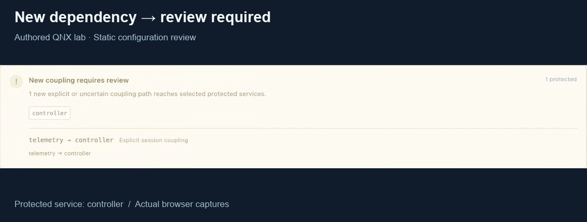

# BootWeave

**BootWeave explains which QNX startup edits introduce coupling to protected services, and can reject those changes in CI.**

[Watch the 2:10 narrated demo](https://www.youtube.com/watch?v=DT4t-2V39rI) · [Tutorial](docs/TUTORIAL.md) · [Host checks](https://github.com/nobelchowdary/bootweave/actions/workflows/review.yml) · [MIT license](LICENSE)



## Quick Start

With Git and Python 3.11+ installed:

```sh
git clone https://github.com/nobelchowdary/bootweave.git
cd bootweave
python3 -m bootweave serve
```

Open [localhost:8765](http://127.0.0.1:8765). On Windows, `py -3 -m bootweave serve` is the equivalent third command. The core review tool needs no account, SDK or target connection.

## Try the regression and its correction

1. Choose **native-risky.xml** and select `telemetry` to inspect its session path to `controller`.
2. In **Change review**, compare the revised baseline against the risky candidate, protect `controller`, and run the check. The policy explains the new path; swap revisions to review the correction.
3. In **Configuration review**, load the matching captured recording and check its association with the active XML. Export a review bundle to retain the static report, imported recording and current binding result.

Each revision can also be imported or edited independently. The same Python engine supplies browser review and CLI/CI checks.

## What the native experiment shows

We deliberately added an unnecessary dependency in an authored three-service QNX lab. BootWeave flagged it, and recorded execution showed the controller restart when optional telemetry failed.

| After the telemetry fault | Risky configuration | Revised configuration |
| --- | --- | --- |
| Telemetry instance | Replaced | Replaced |
| Controller instance | Replaced | Retained, with further successful sensor IPC samples |
| Sensor instance | Unchanged | Unchanged |

The [native source and retained recordings](native/README.md) include exact configurations, process identities, IPC counters, raw artifacts and cleanup checks. Recordings are imported, not a live connection; matching XML hashes do not authenticate their origin. Sampled observations do not establish continuous availability or timing guarantees.

## Who it is for

BootWeave is built for **QNX platform, integration and release engineers** in automotive and industrial systems. The intended review is concrete: determine whether a diagnostics or telemetry change introduces a new lifecycle prerequisite to an essential service, then make that check repeatable in CI. QNX supplies native message passing and process supervision; BootWeave adds a review layer for the configurations that connect those processes. Production adoption and time savings have not been measured.

The older **robot-risky.xml** and **robot-revised.xml** examples remain illustrations; their robot executables are not included. The supplied [native workload](native/README.md) uses a software sensor. Licensed QNX SDK tools are obtained separately for native reproduction.

## CLI and CI

```sh
python3 -m bootweave analyze examples/robot-risky.xml
python3 -m bootweave analyze examples/robot-revised.xml --format json
python3 -m bootweave analyze examples/robot-revised.xml --format html --output review.html

# Reject a change that newly couples motion-control to a prerequisite.
python3 -m bootweave compare examples/robot-revised.xml examples/robot-risky.xml --protect motion-control

# The correction passes the same policy.
python3 -m bootweave compare examples/robot-risky.xml examples/robot-revised.xml --protect motion-control

# Native workload: reject the seeded regression (exit 1), accept its correction.
python3 -m bootweave compare native/configs/revised.xml native/configs/risky.xml --protect controller
python3 -m bootweave compare native/configs/risky.xml native/configs/revised.xml --protect controller

# Check a captured recording's exact XML binding; does not authenticate origin.
python3 -m bootweave evidence native/configs/revised.xml native/evidence/revised-automatic-evidence.json

python3 -m unittest discover -s tests -v
```

`analyze` exits 1 on errors or incomplete input; `--fail-on warning` also rejects warnings. `--fail-on never` is for inspecting deliberately broken inputs. `compare` exits 1 if either graph cannot be evaluated, the candidate has errors, a protected name is missing, or explicit/possible coupling to a protected component is added. Operational failures exit 2. JSON and self-contained HTML reports can be saved locally; no hosted service or account is required.

## What the model means

- Startup prerequisites traverse every dependency edge.
- Explicit session coupling traverses only `state="session"` edges. It describes lifecycle coupling when prerequisite stop/restart propagation applies.
- Possible coupling crosses at least one dependency whose state was omitted. The QNX 8.0 reference does not state the omitted-state default; BootWeave preserves the uncertainty.
- Stateless edges stop the session-coupling traversal. Application reconnect behavior is outside this model.
- Repair modes, SLM launch options, runtime state, and manual `slmctl` operations affect actual recovery. Manual restart has separate stateless handling. This tool does not emulate SLM or predict availability, successful recovery, or boot timing.
- A `critical` launch can cause a system crash on unexpected process death. A component-only graph cannot describe that outcome.

Malformed XML, unknown structural syntax, entities/includes, and invalid graphs cannot receive a complete clean result. External entities are valid SLM features, but are not yet supported by this standalone-file analyzer. Readiness warnings are review prompts, not proof of a defect. Pathname existence and fixed delays do not prove application health.

The comparison summarizes component properties, dependencies, module membership and findings. Protected services can be selected in the browser or CLI. Non-graph properties are retained for comparison; their internal languages (for example, ability specifications) are not validated. Exported comparison JSON retains the policy; a configuration review bundle can retain an imported recording and its current binding check.

Semantics are grounded in the [QNX 8.0 SLM reference](https://qnx.com/developers/docs/8.0/com.qnx.doc.neutrino.utilities/topic/s/slm.html) and [slmctl reference](https://qnx.com/developers/docs/8.0/com.qnx.doc.neutrino.utilities/topic/s/slmctl.html). No QNX software is redistributed. No third-party assets, fonts, runtime libraries, or API services are bundled.

## Hackathon status

Working developer tool for **Developer Tooling & Host Tools**, published at [nobelchowdary/bootweave](https://github.com/nobelchowdary/bootweave). The host tool runs on macOS, Linux, and Windows with Python; this does not imply that QNX compiler tools run natively on each host. The [native application experiments](validation/evidence/native-demo/README.md) record automatic failure and plain manual restart separately for both configurations, with actual QNX message passing, independent process/heartbeat observations and verified cleanup. The [six-case validation matrix](validation/matrix/README.md) covers selected graph, module, readiness and unsupported-include cases. These scoped observations do not establish complete SLM compatibility, continuous availability or real-time performance. The [earlier restart-option discrepancy](validation/evidence/2026-11-24/README.md) remains explicit.

The [current 2:10 YouTube demonstration](https://www.youtube.com/watch?v=DT4t-2V39rI) is public, with signed-out playback verified November 24. It includes 27 burned-in caption cues; selectable English (United States) captions are published and were verified in the signed-out player. [Current media sources and captions](docs/media/v2/README.md) are retained. The new video is saved and embedded in Devpost, and all personal feedback ratings are saved. The entry remains **DRAFT (4/5)**, with the final agreement unchecked and submission pending.

See [idea research](docs/RESEARCH.md), [the build plan](docs/PLAN.md), [submission checklist](docs/SUBMISSION-CHECKLIST.md), [Ubuntu/AWS host setup](docs/AWS-QNX-HOST.md), [QNX validation procedure](docs/QNX-VALIDATION.md), [demo storyboard](docs/DEMO-SCRIPT.md), and [report schema](docs/report-schema.md).

MIT licensed. QNX names describe the supported platform; this project is independently authored and is not endorsed by QNX or BlackBerry.
