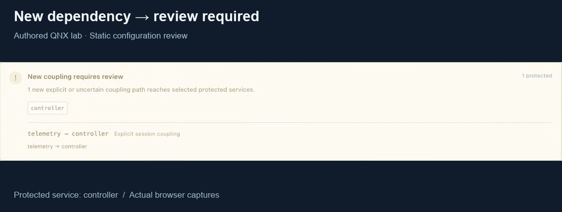
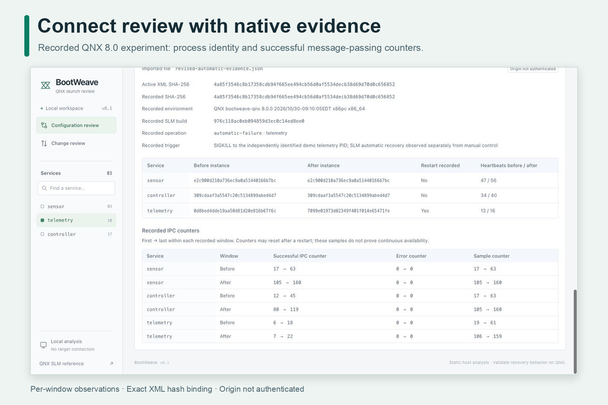

# BootWeave — Devpost draft

**Submission draft — final entry still pending.** The implementation, browser QA, narrated 2:33 demo and five gallery images are prepared. The [YouTube demonstration](https://www.youtube.com/watch?v=m-SxmSBkiLo) is public, with signed-out playback verified November 24, 2026. Captions are burned in and an SRT was uploaded; selectable English (United States) captions were also verified in the signed-out player. The video URL is saved in Devpost and renders in the project preview. Both entrant-confirmed personal feedback answers are saved in Devpost; the final agreement and submission remain pending. See [media and captions](media/README.md) and [browser checks](BROWSER-QA.md).

## Form fields

| Field | Draft value |
| --- | --- |
| Project name | BootWeave |
| Tagline | Catch hidden QNX service dependencies before deployment. Review XML changes visually, protect essential services in CI, and inspect native QNX experiment results. |
| Category | Developer Tooling & Host Tools |
| Source | https://github.com/nobelchowdary/bootweave |
| Devpost project | https://devpost.com/software/bootweave-vilw4u — final hackathon entry pending |
| Demonstration video | https://www.youtube.com/watch?v=m-SxmSBkiLo — 2:33.45; public and signed-out playback verified November 24 |
| Tutorial bonus URL | https://github.com/nobelchowdary/bootweave/blob/main/docs/TUTORIAL.md |
| Built with — implemented source | Python, JavaScript, HTML, CSS, C, QNX 8.0 SLM, slmctl, QNX message passing, QEMU, Ubuntu |
| Native workload toolchain | QNX `qcc -Vgcc_ntox86_64`, GCC 12.2.0 target toolchain, C11; cross-compiled on Ubuntu and executed on the recorded QNX x86-64 guest |

## Public project story

**[Watch the 2:33 demonstration](https://www.youtube.com/watch?v=m-SxmSBkiLo)** · [Source and instructions](https://github.com/nobelchowdary/bootweave) · [Tutorial](https://github.com/nobelchowdary/bootweave/blob/main/docs/TUTORIAL.md)

## Inspiration

One extra XML dependency made a controller restart when optional telemetry failed. We deliberately introduced it in our three-service QNX lab to demonstrate the risk and its correction.

The controller's code only read the sensor. An unnecessary QNX SLM session dependency connected its lifecycle to telemetry anyway. BootWeave makes that configuration relationship visible before deployment.

It is built for **QNX platform, integration and release engineers** who review startup changes and need an explainable CI guard.

## What it does

BootWeave is a local review workbench for QNX 8.0 System Launch and Monitor XML. Import baseline and candidate files independently, select a protected service, and compare startup prerequisites, lifecycle coupling, service properties and module membership. Findings show the dependency path and source context.

Adding the telemetry dependency fails the protected-controller policy; removing it passes. The same Python engine drives the browser and CLI, so teams can use the review interactively and enforce it in CI. Invalid, cyclic and unsupported input stays visibly failed or incomplete.

## Potential impact

The intended users are platform teams integrating QNX services in vehicles and industrial systems. An automotive team could review whether a diagnostics change adds a new prerequisite to a controller; an industrial team could check a telemetry update before integrating it with control software. BootWeave exposes the dependency path and makes the same check repeatable in CI.

QNX provides native message passing and SLM process supervision. BootWeave adds a review layer for the configuration that connects those processes. The distinctive workflow links an XML change, an explained policy result and a retained native experiment.

## How we built it

The host tool uses Python 3.11+, JavaScript, HTML and CSS. It needs no target connection to analyze XML. Its QNX-specific model covers SLM dependency states, readiness settings and modules: the relationships platform engineers must inspect when a configuration change crosses service boundaries.

We also wrote three C services using QNX `name_attach`, `MsgReceive`, `MsgReply`, `name_open`, `MsgSend` and `TimerTimeout`. We built with `qcc -Vgcc_ntox86_64` / GCC 12.2.0 and executed on QNX 8.0.0 x86-64 under QEMU/KVM.

AI tools assisted development, research and documentation. The video uses disclosed synthetic narration. BootWeave's runtime analysis is deterministic and requires no AI model or API.

## Demonstrated QNX behavior

We killed only the identified telemetry process and recorded SLM recovery, OS process queries and independent UDP process-instance/IPC observations.

| Observed after telemetry failure | Risky configuration | Revised configuration |
| --- | --- | --- |
| Telemetry instance | Replaced | Replaced |
| Controller instance | Replaced | Retained; successful sensor IPC increased |
| Sensor instance | Unchanged | Unchanged |

Separate plain-manual-restart recordings showed the same configuration contrast. All four application recordings used fresh dedicated SLM instances and verified cleanup. The workbench imports these records, checks their XML hash association and exports the review with its evidence.

## Challenges we ran into

An early four-process SLM test exposed an unresolved surprise: the stateless dependent kept its PID after `restart bw-prerequisite`, but was replaced after `restart -s bw-prerequisite` on the recorded build. We preserved both command logs and build IDs, then ran the native application’s automatic-failure tests separately rather than treating manual restart as proof of recovery.

## Accomplishments that we're proud of

We connected a reviewable configuration edit to a failing/passing CI policy and an observable native QNX application contrast. The repository includes **46 host tests**, browser checks, four application recordings, six native matrix cases and a tutorial.

## What we learned

Configuration deserves code-level scrutiny. A useful review tool shows why a change matters, while native experiments can challenge its assumptions. That combination makes decisions easier to inspect and reproduce.

## What's next for BootWeave

Test more SLM builds and readiness modes, repeat across fresh VM boots, investigate the option discrepancy, improve large-graph reports, and collect reproduction feedback from QNX engineers. We have not measured customer adoption or time savings.

**Scope:** These recordings cover a software sensor lab on one QNX/SLM build, with no safety, availability or timing guarantee; XML hashes do not authenticate origin. BootWeave is MIT licensed; [full evidence and reproduction details](https://github.com/nobelchowdary/bootweave/tree/main/validation/evidence/native-demo) are public, with licensed QNX tools obtained separately.

## Build and run field

Host product: Python 3.11+; tested instructions are in the [README](https://github.com/nobelchowdary/bootweave#readme). Run `python3 -m bootweave serve` from the checkout and open `http://127.0.0.1:8765`. The CLI comparison command and expected failing/passing sample are documented there.

Native workload: QNX 8.0.0 x86-64 under QEMU 8.2.2/KVM, built using QNX `qcc -Vgcc_ntox86_64` / GCC 12.2.0. See the [native build and capture instructions](https://github.com/nobelchowdary/bootweave/blob/main/native/README.md), [host/image setup](https://github.com/nobelchowdary/bootweave/blob/main/docs/AWS-QNX-HOST.md), and [evidence index](https://github.com/nobelchowdary/bootweave/tree/main/validation/evidence/native-demo). Licensed SDK tools and guest images are obtained separately; they are not redistributed.

## Final editor checks — do not paste as project claims

- The verified public YouTube URL is saved in Devpost and embedded in its project preview. Burned-in captions and an uploaded SRT are present; selectable English (United States) captions rendered in the signed-out player.
- Retain the completed browser QA and demonstrated source revision with the release media.
- The entrant explicitly confirmed “Very likely” for QNX reuse and “Significantly” for skills learned; both were saved and verified in the live form November 24.
- Preserve material limitations and the unresolved operation-specific discrepancy.
- The entrant confirmed basic eligibility and individual entry. Confirm the completed entry and its final ownership/contribution statements at submission time.
- Official [submission requirements and judging](https://qnx.devpost.com/rules) govern the entry. No placement or prize is guaranteed.
